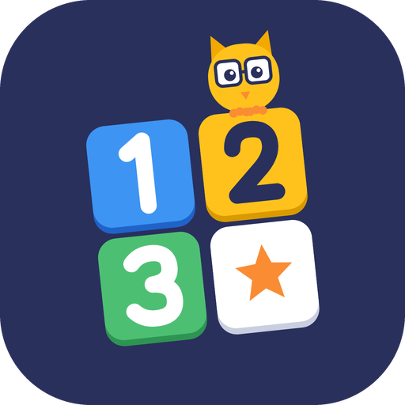

<p align="center"></p>

# Sudoku Kids

A free, ad-free Sudoku app for iPhone and iPad that helps kids get excited about logic and numbers.

## What's inside

- **Three board sizes**: 4×4 (Tiny), 6×6 (Junior) and 9×9 (Classic), each at Easy 🐣, Medium 🐥, Hard 🦊 and Expert 🦁
- **Pictures or numbers**: play with numbers, animals, fruit, sea life or colours
- **Modes**
  - **Adventure** 🗺️: 5 themed worlds, 30 levels that unlock one by one, stars on every level
  - **Play**: pick any size and level
  - **Daily Challenge** 📅: one 9×9 puzzle a day, the same for everyone, with a day streak 🔥
  - **Learn** 🦉: four short lessons (Last Number Left, Only Spot Left, Pointing Line, Twin Squares) with a real example and a quiz, plus practice games with unlimited hints
- **Hints that teach**: a hint highlights the squares involved and explains *why* the answer fits. It points out mistakes first, uses the four techniques, and can **read itself out loud**
- Every puzzle has exactly one answer. Easy and Medium only need the two beginner techniques; Hard can always be solved with all four
- Notes, **Auto notes**, undo, erase, timer, stars, confetti, sounds and vibration
- **17 trophies** to collect
- **Settings**: show mistakes right away or only at the end, optional **3-mistake challenge**, read hints aloud, sounds, vibration
- **Players**: up to 6 profiles, each with their own stars, trophies, saved game and settings
- **Grown-ups area** behind a parental gate: progress per child, play time today and this week, a **break reminder**, edit/reset/remove players
- Free, with no ads, no purchases, no accounts and no data collection. Everything stays on the device

The logo source is `design/logo.svg`; `design/logo.png` is the 1024×1024 app icon.

## Project layout

```
SudokuKids/
  Engine/        Grid sizes, generator, solvers, hints, lessons, adventure, trophies (pure Swift, unit tested)
  Model/         Game state, profiles and progress storage, sounds, speech, haptics
  Views/         SwiftUI screens
  Assets.xcassets
SudokuKidsTests/ Unit tests for the engine
project.yml      XcodeGen project definition
.github/workflows/ios.yml   CI: test on every push, upload to TestFlight from main
```

## Run it on your Mac

1. Install Xcode (latest) and XcodeGen: `brew install xcodegen`
2. In this folder: `xcodegen generate`
3. Open `SudokuKids.xcodeproj`, pick a simulator, press ▶︎

To run on your own iPhone, select the SudokuKids target → Signing & Capabilities → choose your team.

## GitHub Actions

`.github/workflows/ios.yml` has two jobs:

| Job | When it runs | What it does |
| --- | --- | --- |
| Build & test | every push and pull request | generates the project, builds, runs unit tests on an iPhone simulator |
| Upload to TestFlight | pushes to `main`, when enabled | archives, signs (automatic cloud signing) and uploads to App Store Connect |

### Turning on TestFlight uploads

You need a paid Apple Developer account.

1. **Bundle ID**: Certificates, IDs & Profiles → Identifiers → + → App ID. Use the same ID as `PRODUCT_BUNDLE_IDENTIFIER` in `project.yml` (default `com.gudivada.sudokukids`; change it there if you pick another).
2. **App record**: App Store Connect → Apps → + New App, using that bundle ID.
3. **API key**: App Store Connect → Users and Access → Integrations → App Store Connect API → Team Keys → +. Give it **Admin** access (needed so CI can create the signing certificate). Download the `.p8` file and note the Key ID and Issuer ID.
4. **Repository secrets** (Settings → Secrets and variables → Actions → Secrets):
   - `ASC_KEY_ID`: the key's ID
   - `ASC_ISSUER_ID`: the Issuer ID shown above the key list
   - `ASC_PRIVATE_KEY`: the full contents of the `.p8` file, including the BEGIN/END lines
   - `APPLE_TEAM_ID`: your 10-character Team ID (developer.apple.com → Account → Membership details)
5. **Repository variable** (same page → Variables tab): `ENABLE_TESTFLIGHT` = `true`

Push to `main` (or run the workflow manually from the Actions tab). The build number is the workflow run number, so every upload is unique. Builds show up in TestFlight after Apple finishes processing, usually within 30 minutes.

### Notes

- Never commit the `.p8` key; `.gitignore` blocks it.
- If you list the app in the App Store **Kids** category, Apple requires no third-party ads or analytics. This app has none.
- The workflow uses the `macos-26` runner with the latest stable Xcode, which Apple requires for App Store uploads.
